<div align="center">



<br>

<a href="https://github.com/KevinD003/KevinD003/issues/new?template=recruiter-inquiry.yml"></a>
<a href="https://thedesievents.com"></a>
<a href="https://kevind003.github.io/KevinD003/"></a>

</div>

<br>

## 01 · Letter to Shareholders

> I came up through **finance** — reconciliations, forecasts, month-end close, the
> spreadsheet that runs the business. In 2026 I started shipping software with an
> **AI-native workflow** (Claude Code as the pair, me as the PM, architect and auditor).
>
> The result is a portfolio of **seven products in seven industries** — one live
> marketplace, a multi-tenant CRM, a personal-finance ledger, an ML fare-forecasting
> engine — each with tests, decision logs and an honest limitations ledger.
>
> **The edge:** I understand the P&L *and* the pull request. I know which number the
> CFO will ask about, and I can build the system that produces it.
>
> — *Kevin Davra, Dallas, TX*

<br>

## 02 · Key Metrics



<sub>Measured from source across all product repos (Oct 2026). "0 made-up numbers" is a house rule: every repo documents what is proven, what is mocked and what is blocked.</sub>

<br>

## 03 · Portfolio — Business Units



| Ticker | Business unit | The problem → what I built | Stack | Status |
|:--|:--|:--|:--|:--|
| **`$DESI`** | **[The Desi Events](https://thedesievents.com)** | South Asian events live on WhatsApp forwards and Google Forms → a real ticketing marketplace: discovery, checkout, per-event booking fees, referral codes, door payments kept outside the ledger. 3 apps on 13 shared packages, ADR-driven. | Fastify · Next.js · BullMQ · PostgreSQL · Redis · Prisma | 🟢 **Live** · [code](https://github.com/KevinD003/projectX) |
| **`$LEAD`** | **LeadFlow** | Sales teams juggle five tools to find and work a lead → a multichannel lead-gen CRM. Multi-tenant (DB-per-company), 226 API endpoints, 27-route dashboard, 17-category security audit. | Python · React 19 · TypeScript · Vite · SQLite → Supabase | 🟢 Private beta |
| **`$TALY`** | **Tally** | Your money lives in four bank CSVs → one honest ledger. Auto-import (Amex, Chase, Wells Fargo), ML categorization that learns, budgets, month-end close checklist, 24-month cash-flow forecast, Splitwise sync. | FastAPI · React · TypeScript · scikit-learn · Claude | 🔵 v1 · local-first |
| **`$VACA`** | **Vacamodiq** | "Should I book this flight now or wait?" → fare monitoring + forecasting + booking-decision engine. Booking saga, payments ledger, fraud/underwriting, circuit breakers, cross-language conformance vectors. | Python · LightGBM · Next.js · Postgres · Docker | 🟣 R&D · synthetic data |
| **`$KAIL`** | **Kailo.fit** | Runners' data is trapped in watch apps → AI training companion: 3D route flythroughs, Riegel race predictions, AI-generated periodised plans, live GPS tracking, and an **MCP server** so you can ask Claude about your training. | Next.js · Supabase · Mapbox · Recharts · Claude API | 🔵 Beta |
| **`$NOEF`** | **NoEfforts** | Job hunting is copy-paste at scale → one reviewed profile, collected jobs, prepared answers — **nothing sent without human approval**, unknown facts never guessed. | FastAPI · Celery · Next.js · Playwright · Postgres | 🟣 Phase A · [code](https://github.com/KevinD003/AutoApply) |
| **`$STIQ`** | **STITCHIQ** | Embroidery digitizing is slow, manual, expensive software → browser studio: image → stitches via computer vision, 45+ machine formats, 3D thread preview, production-package export. 110 tests green. | FastAPI · OpenCV · React · Konva · Three.js | 🔵 Beta |

<sub>🔒 Most repositories are private — code walkthroughs and live demos available on request.</sub>

<br>

## 04 · Operating Model — how I ship

```text
 PROBLEM          SPEC              BUILD                 PROVE                 DISCLOSE
 ───────          ────              ─────                 ─────                 ────────
 A finance-   →   ADRs + a     →    AI-paired dev     →   unit · e2e ·      →   STATUS · LIMITATIONS
 shaped pain      decision log      (Claude Code)         security tests        · DECISION_LOG in
                                    small, reviewed PRs   CI gates every PR     every single repo
```

- **Controls first.** Payments default to mock and *refuse to boot* with live keys. Auto-apply never submits without approval. Every query in LeadFlow is scoped by tenant. I design like an auditor will read it — because one will.
- **Numbers you can trace.** Tally's rule: a figure is computed from stored data by a documented formula, or it shows a dash and a reason. Never a zero standing in for "unknown".
- **AI as leverage, not autopilot.** I own the product decisions, the architecture and the review. The model writes a lot of code; I decide what ships.

<br>

## 05 · Capabilities

<table>
<tr><td><b>Finance &amp; Business</b></td><td>


</td></tr>
<tr><td><b>AI</b></td><td>


</td></tr>
<tr><td><b>Languages</b></td><td>


</td></tr>
<tr><td><b>Product stack</b></td><td>


</td></tr>
<tr><td><b>Ship &amp; operate</b></td><td>


</td></tr>
</table>

<br>

## 06 · Shipping Cadence — live


<sub>Not a stock widget. Every pillar is one real day of my commit history, regenerated every morning by a GitHub Action I wrote. Quiet stretches become labelled chasms. <a href="https://kevind003.github.io/KevinD003/">Take the controls →</a></sub>

<details>
<summary><b>How COMMIT RUN works</b> (for the engineers in the room)</summary>

<br>

1. **Real data.** A scheduled Action pulls my contribution calendar from the GitHub GraphQL API into `data/contributions.json`.
2. **Generated, not drawn.** `tools/gen-runner.mjs` turns each active day into a pillar scaled to the busiest day; runs of 3+ zero days collapse into one labelled gap.
3. **Simulated motion.** Every height change is a parabolic arc solved by binary search so the runner clears both ledges and never clips the HUD.
4. **Zero JavaScript.** The solved path is baked into SMIL `<animate>` keyframes, because GitHub strips scripts from READMEs. ~48 KB, runs anywhere an `` does.

```
tools/fetch-contributions.mjs   GraphQL  ->  data/contributions.json
tools/gen-runner.mjs            data     ->  assets/commit-run.svg  +  docs/level.js
.github/workflows/commit-run.yml          ->  re-runs both, every morning
```

</details>

<br>

## 07 · Risk Factors &amp; Forward-Looking Statements

- **Risk:** Candidate may automate your team's manual reporting within the first 90 days.
- **Risk:** Candidate will ask "where does this number come from?" — and then build the lineage.
- **Guidance FY2027:** Moving into a full-time role at the intersection of **finance and AI** — finance transformation, FP&amp;A automation, AI solutions / product, or fintech engineering.

<br>

## 08 · Investor Relations

<div align="center">

**Hiring for finance × AI, fintech, or a builder who speaks CFO?**

<a href="https://github.com/KevinD003/KevinD003/issues/new?template=recruiter-inquiry.yml"></a>
<a href="https://github.com/KevinD003"></a>

<sub>📍 Dallas, Texas · open to on-site, hybrid and remote</sub>

<br><br>

<sub><code>$DESI</code> · <code>$LEAD</code> · <code>$TALY</code> · <code>$VACA</code> · <code>$KAIL</code> · <code>$NOEF</code> · <code>$STIQ</code> — this is not investment advice, but it is a good hire.</sub>

</div>
